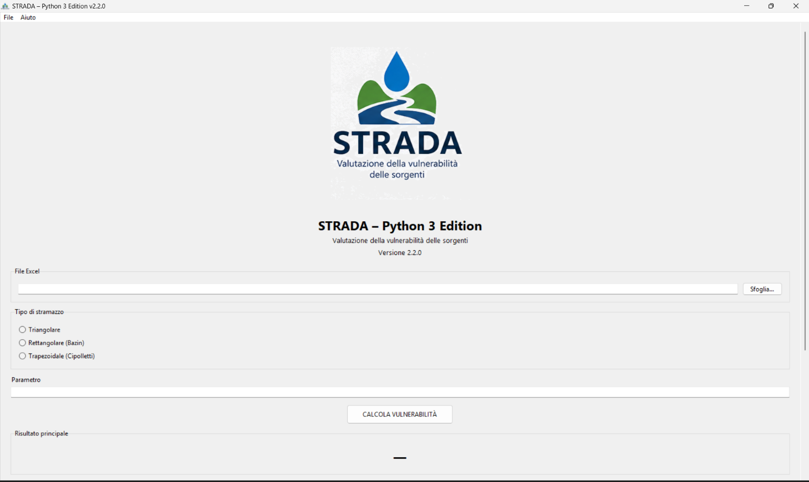
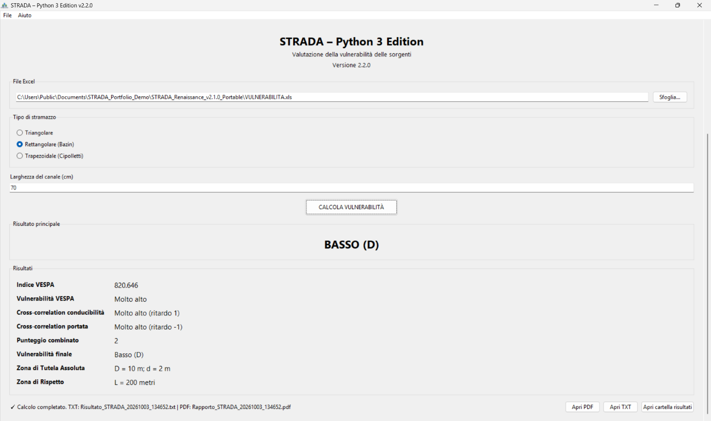

# STRADA Renaissance

## Legacy scientific software modernization — Python 2 to Python 3

STRADA Renaissance is a portfolio case study documenting the modernization of a legacy scientific desktop application originally developed in Python 2.

The goal of the project was to preserve the historical calculation workflow while making the application usable on current Windows systems and modern Python environments.

> This repository documents the modernization process. It does not redistribute the original STRADA source code, original datasets, or application binaries.

## Screenshots

### Python 3 desktop interface



### Reference calculation result



## Project scope

The modernization work included:

- Migration from Python 2 to Python 3
- Preservation of the original calculation workflow
- Modern Windows-compatible execution
- Graphical desktop interface and command-line mode
- Legacy Excel `.xls` input support
- Automatic TXT and PDF report generation
- Portable Windows distribution
- Windows installer generation with Inno Setup
- PyInstaller build automation
- Regression testing against the legacy implementation
- Removal of a problematic SciPy runtime dependency by replacing the required cross-correlation operation with NumPy
- Investigation of a discrepancy between the historical STRADA implementation and available VESPA technical documentation

## Legacy compatibility

A key objective was not simply to rewrite the application, but to reproduce the behavior of the original Python 2 implementation as closely as possible.

A reference regression case was used throughout the migration to compare calculated values, cross-correlation delays and final vulnerability classification between the legacy application and the Python 3 implementation.

## VESPA investigation

During modernization, a discrepancy was identified between the thresholds implemented in the historical STRADA source code and thresholds found in technical documentation describing the VESPA method.

Historical STRADA implementation:

| VESPA index | Classification |
| --- | --- |
| V <= 1 | Basso |
| 1 < V <= 10 | Medio |
| 10 < V <= 100 | Alto |
| V > 100 | Molto Alto |

Technical document examined during the project:

| VESPA index | Classification |
| --- | --- |
| V <= 0.1 | Basso |
| 0.1 < V <= 1 | Medio |
| 1 < V <= 10 | Alto |
| V > 10 | Elevato |

An experimental implementation using the documented thresholds was created and tested. However, because the historical STRADA implementation is the software reference used in practice, the legacy thresholds remain the baseline for the preserved version until the methodological difference can be independently validated.

This investigation is included as an example of an important modernization principle: **a discrepancy should be documented and tested before changing established scientific behavior**.

## Technical modernization

The project evolved the application into a reproducible Windows distribution with:

- Python 3
- NumPy
- xlrd
- ReportLab
- PyInstaller
- Inno Setup

The original cross-correlation workflow depended on SciPy. On the target Windows environment, SciPy triggered application-control / DLL loading problems. The specific operation required by STRADA was reproduced with NumPy and regression-tested against the legacy results.

## Repository contents

```text
strada-renaissance-case-study/
├── docs/          Technical and migration documentation
├── examples/      Small, rewritten examples of modernization patterns
├── screenshots/   Application and workflow screenshots
├── NOTICE.md      Attribution and repository scope
└── README.md
```

## What is intentionally not included

To keep this repository focused on the modernization work and avoid redistributing material whose licensing terms have not been established, it does not currently include:

- Original STRADA source code
- Full derived application source code
- Original Excel datasets
- Executable binaries
- Installer packages

## Original project attribution

The historical STRADA software identifies the original work with:

**Politecnico di Torino**<br>
**Programma di Cooperazione Transfrontaliera Italia-Svizzera 2007-2013**

STRADA Renaissance is an independent modernization and portfolio case study. No endorsement by the original institutions is implied.

## Status

The Python 3 modernization has been functionally validated against the available legacy implementation and reference dataset.

This public repository focuses on the engineering process, architecture, compatibility work and validation methodology rather than redistribution of the original software.
